# Finance Tracker: showcase

A personal finance tracker. This page shows the screens, the design decisions, and how the work was done. Use it as the base for a portfolio entry.

## Summary

- **What:** a full-stack web app to record income, expenses, and investments, and see them on one dashboard.
- **Stack:** Vue 3, TypeScript, Tailwind, shadcn-vue, Apollo GraphQL, Express, MongoDB, Docker.
- **My focus:** interface design and front-end quality. I took a working but unfinished app and redesigned it.
- **Style:** white and blue, flat surfaces, thin type, hairline separators, translucent top bar. Inspired by Ubiquiti UniFi and iOS 7 to 10.

## 60-second tour

1. **Log in** (`demo` / `demo1234`). Two-column screen with a soft blue gradient.
2. **Dashboard.** Three totals, a net balance donut with a legend, and the newest transactions.
3. **Add a transaction.** A sheet slides in. Amount accepts decimals. The date defaults to today.
4. **Delete a transaction.** A dialog asks first. Focus starts on "Keep".
5. **Switch to dark mode.** Every screen follows the theme, including the chart.
6. **Resize to a phone.** One column. The table moves the category under the description.

## Screens

### Desktop

| | |
|---|---|
| 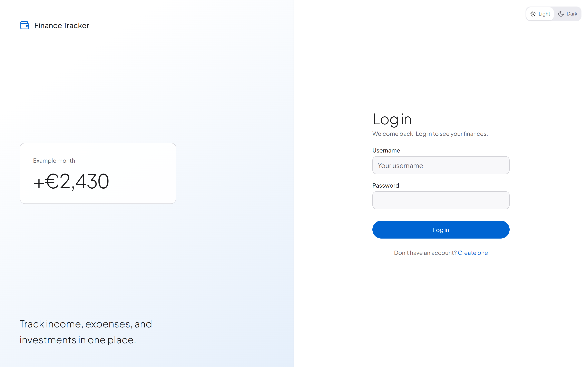 | 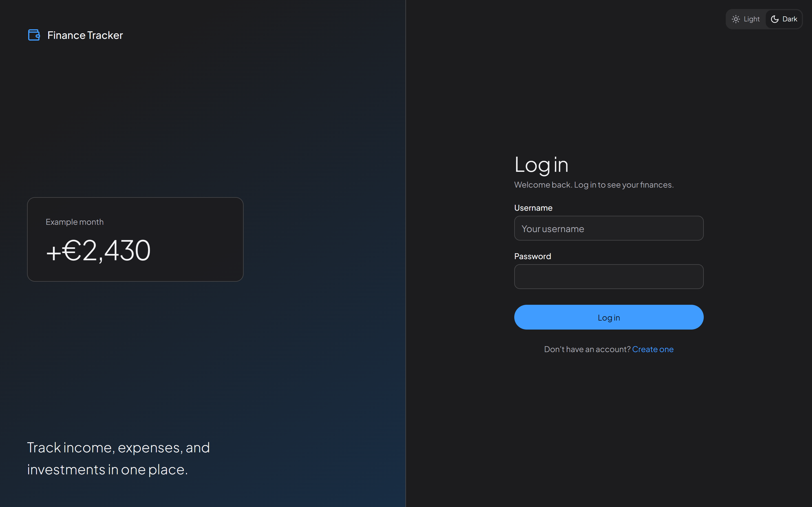 |
| Login | Login, dark |
| 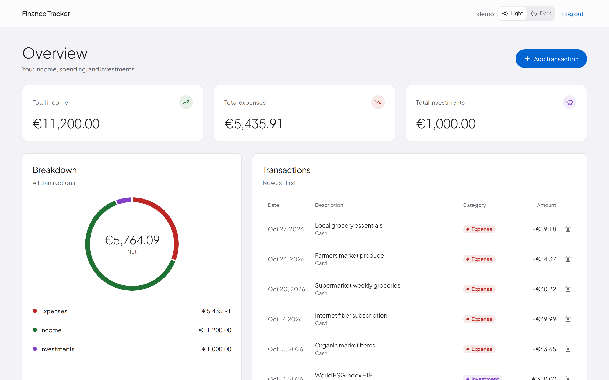 | 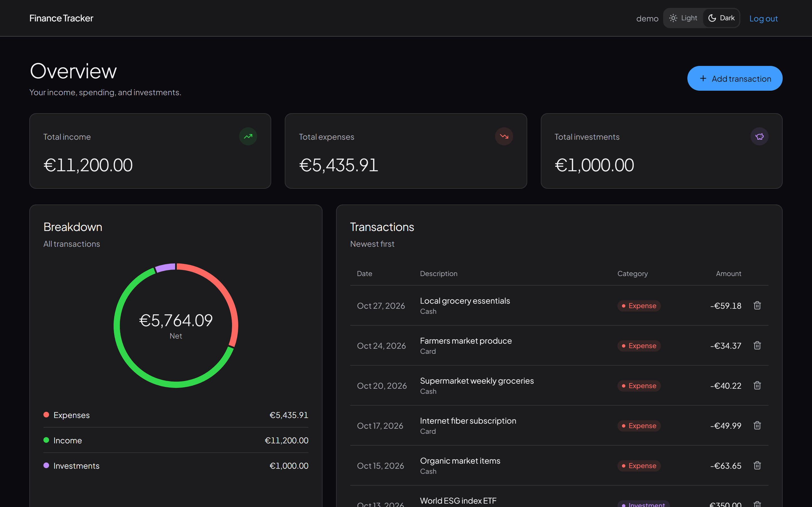 |
| Dashboard | Dashboard, dark |
| 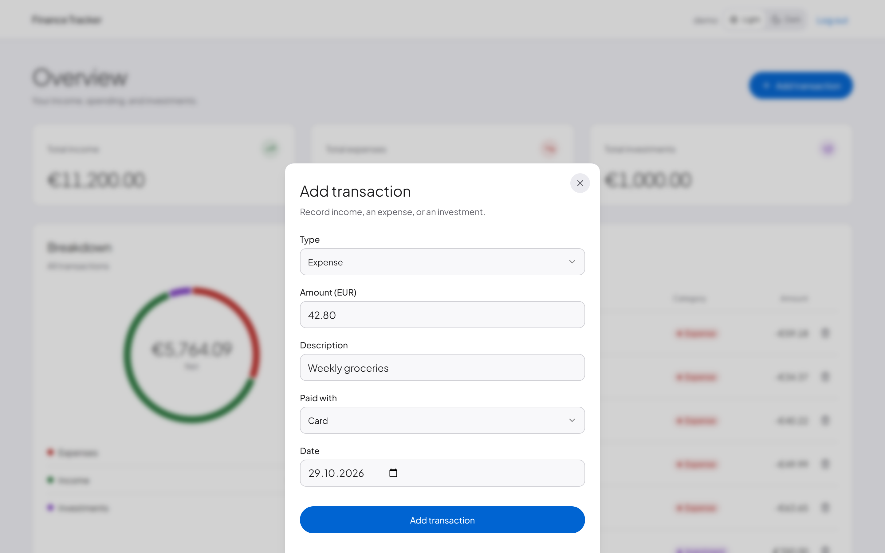 | 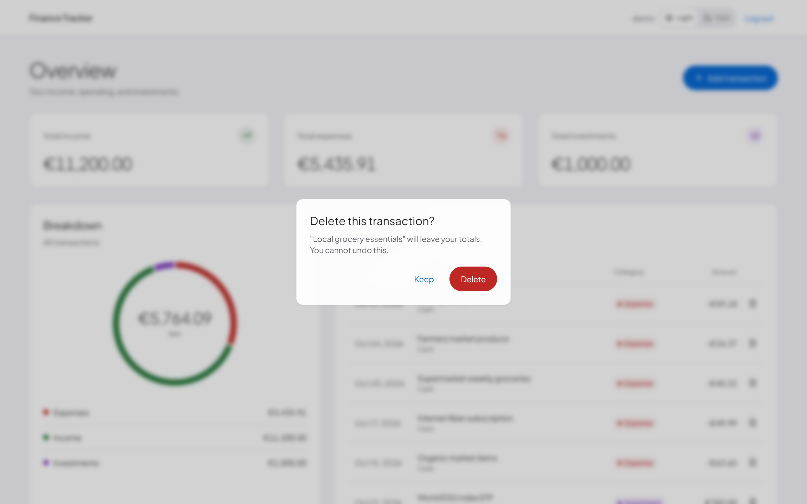 |
| Add transaction | Delete confirmation |
| 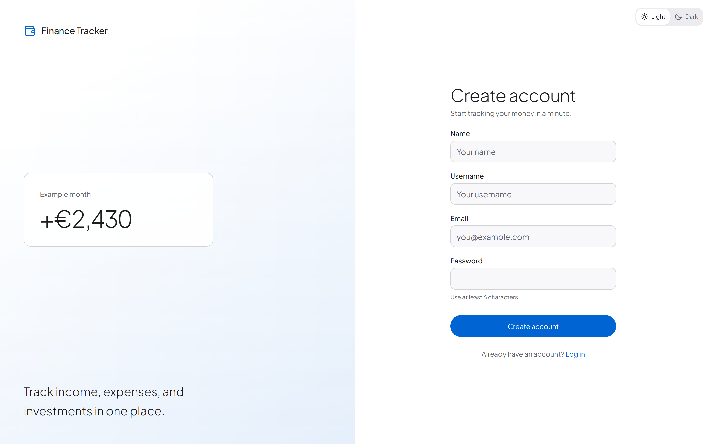 | 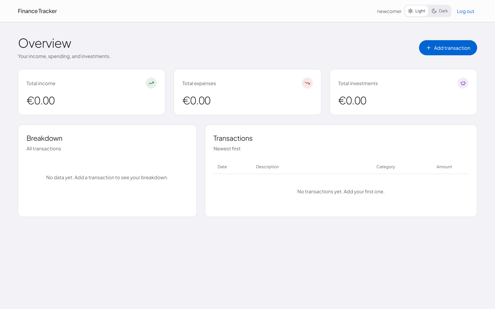 |
| Sign up | Empty state for a new account |
| 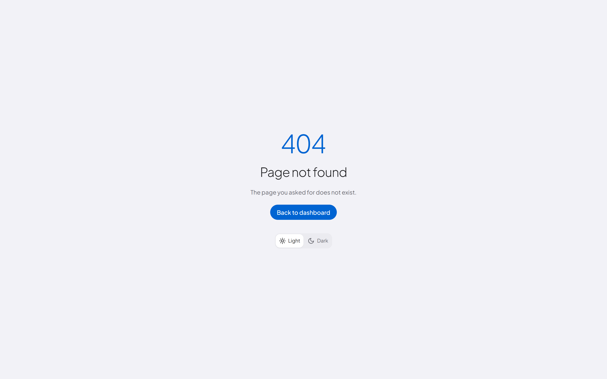 | |
| 404 page | |

### Mobile (390px)

| | | |
|---|---|---|
| 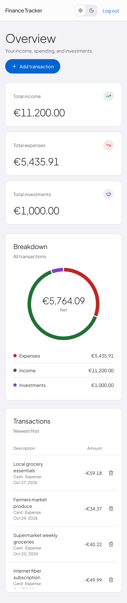 | 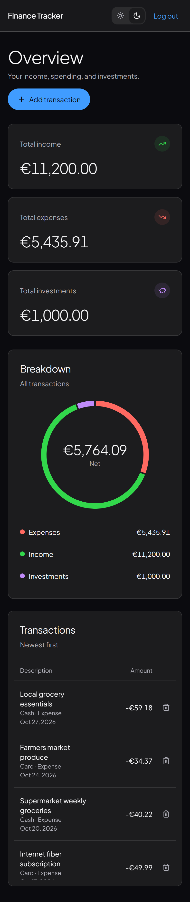 | 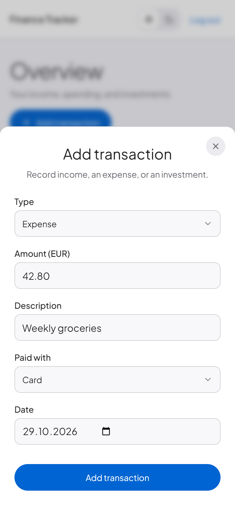 |
| Dashboard | Dashboard, dark | Add transaction |

## Before and after

| Before | After |
|--------|-------|
| 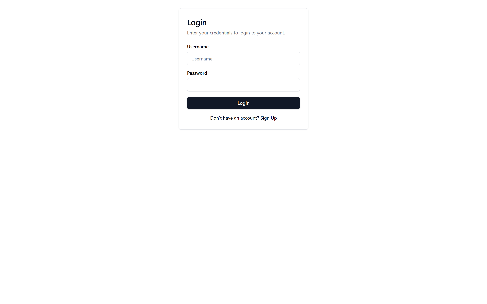 |  |
| 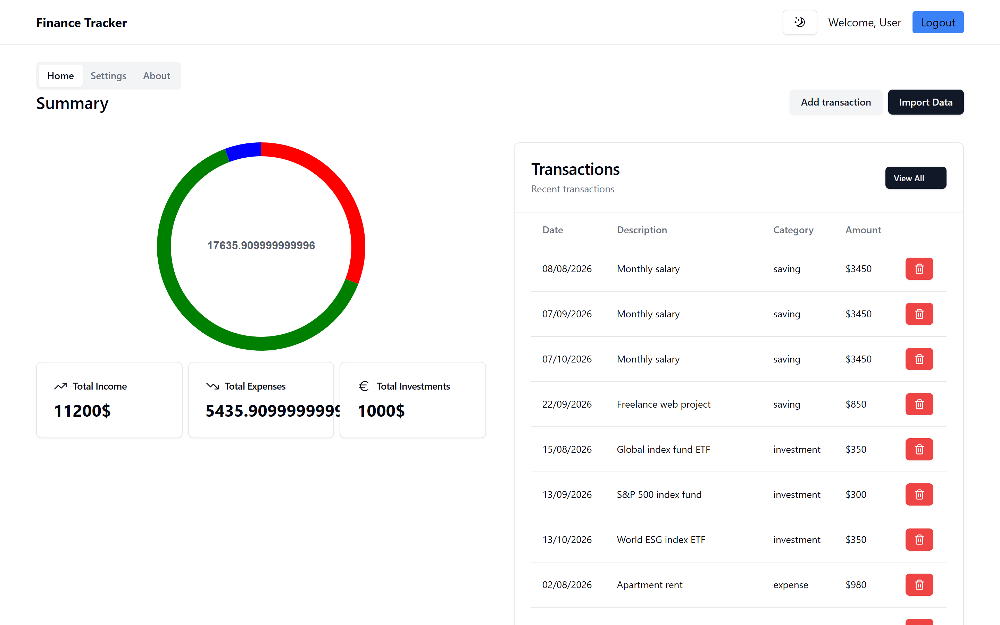 |  |
| 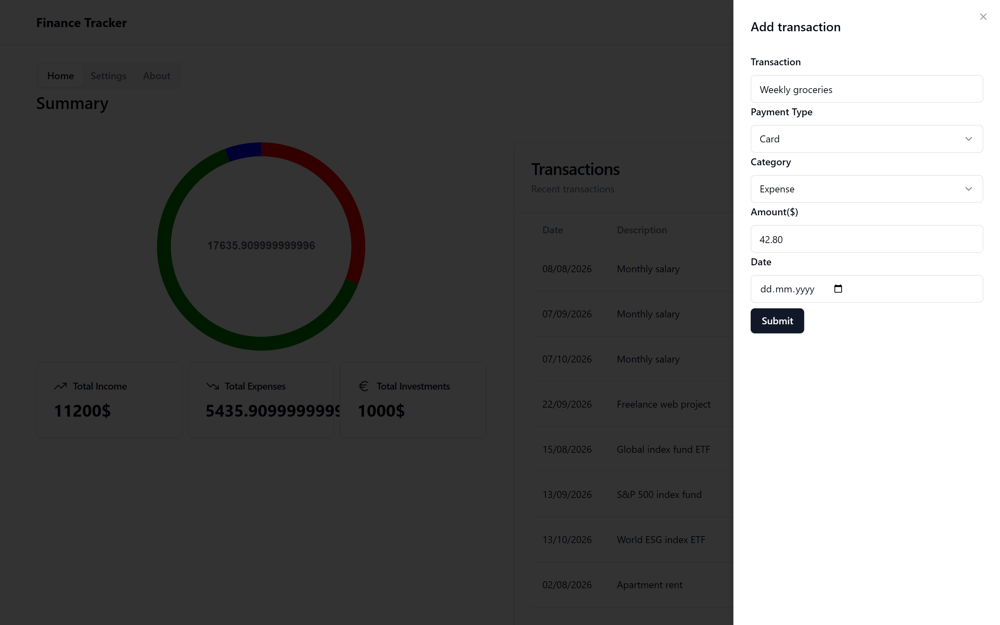 |  |

## Problems found, and what changed

| Problem in the first version | Change |
|------------------------------|--------|
| About 25 template defects: missing icon import, table header with the wrong cell count, hardcoded blue button, `Welcome, User`, stock Vite title and icon | Fixed all. Added a real favicon, title, and 404 page |
| Placeholder Settings and About pages, a mock Import menu, a dead "View All" link | Removed. One dashboard, no dead controls |
| Amount field rejected `12.50`. Selects and date were optional | Decimal input, required fields, date defaults to today |
| Form labels did not focus their inputs | Plain labels tied to inputs |
| Donut mixed income, expense, and investment into one meaningless center number | Center shows net balance. Legend shows each value |
| Chart colors were the words `red`, `green`, `blue` | Theme tokens that follow light and dark mode |
| Dollar signs mixed with a euro icon. Raw dates. Totals such as `5435.909999999` and `17635.909999999996` overflowed the cards | One money formatter (EUR, two decimals) and one date formatter |
| Delete removed a row with no warning | Confirmation dialog, per-row feedback, toast |
| Signup sent the email as the username | Real username field |
| Table: no empty state, no loading state, nothing on error | All three states |

## Design decisions

| Decision | Reason |
|----------|--------|
| One brand blue, three money colors | Easy to scan. Investments use purple so they never look like the brand color |
| Sign and label with every color (`+`, `-`, "Income") | Color is never the only signal. Works for color-blind users |
| Plus Jakarta Sans (bundled, OFL license), Apple system fonts as fallback, tabular numerals for money | Soft, friendly headings with an iOS feel. Numbers line up in columns |
| Flat cards with hairline borders, one soft shadow level | Matches the iOS 7 to 10 look. Keeps the screen calm |
| Confirm before delete, not undo | The API has no restore |
| Keep the donut, add a legend | The donut is weak for unrelated totals. The legend and net label fix most of that. A bar chart is a later option |
| No edit screen | The update mutation needs a fix first. Left out on purpose |

## What I would do next

1. Edit transaction, reusing the add sheet.
2. A transactions page with search, filter, and sort.
3. A monthly income vs expenses bar chart.
4. Hosted demo with sample data.

## Known limits

- Local only. Authentication hardening is out of scope.
- No automated tests. The interface was checked by hand at 360px and 1280px in light and dark mode.
- Not checked in Safari.

## Suggested portfolio text

**Short (one line):** Full-stack finance tracker. I redesigned the interface to a clean white-and-blue style with light and dark themes, and fixed the usability gaps in the first version.

**Medium (case study intro):** The first version worked, but it looked unfinished: placeholder pages, a mock import menu, a form that rejected decimal amounts, and a chart that mixed unrelated totals. I audited every screen, removed what was dead, built one design token set, and rebuilt the dashboard, forms, and sign-in screens. The result is a small app with no dead controls and a clear visual style.
